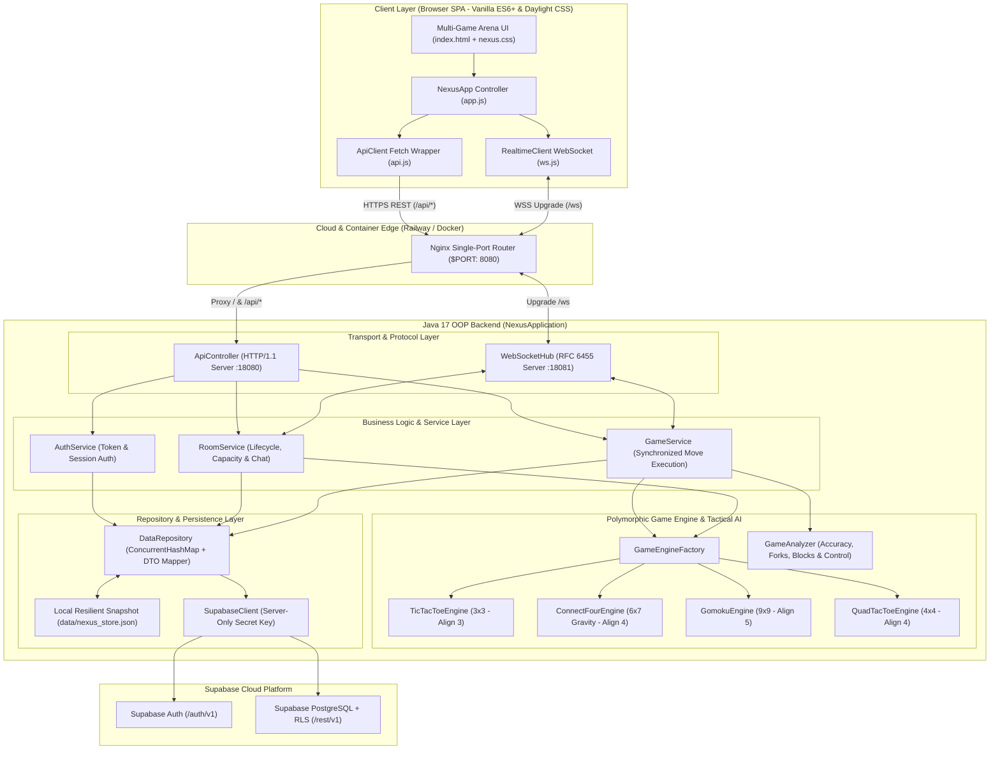
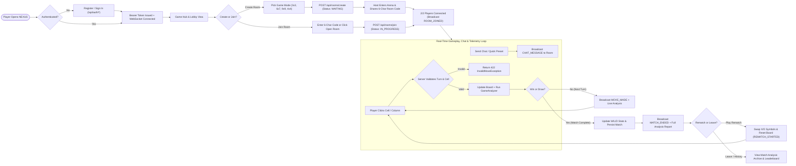
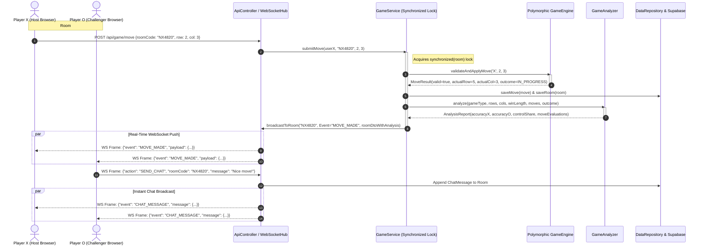
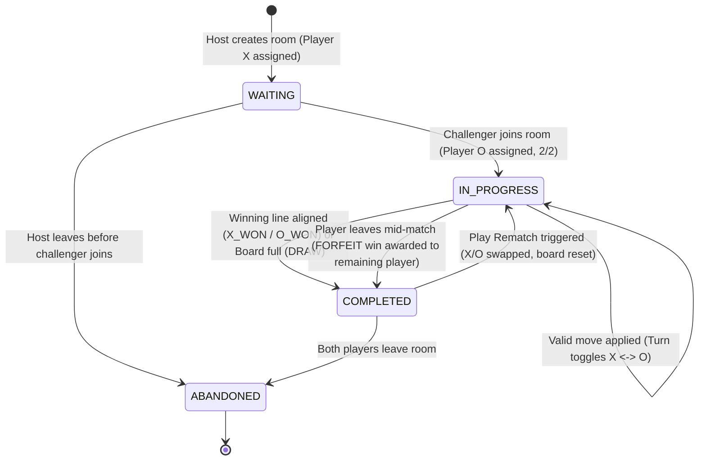
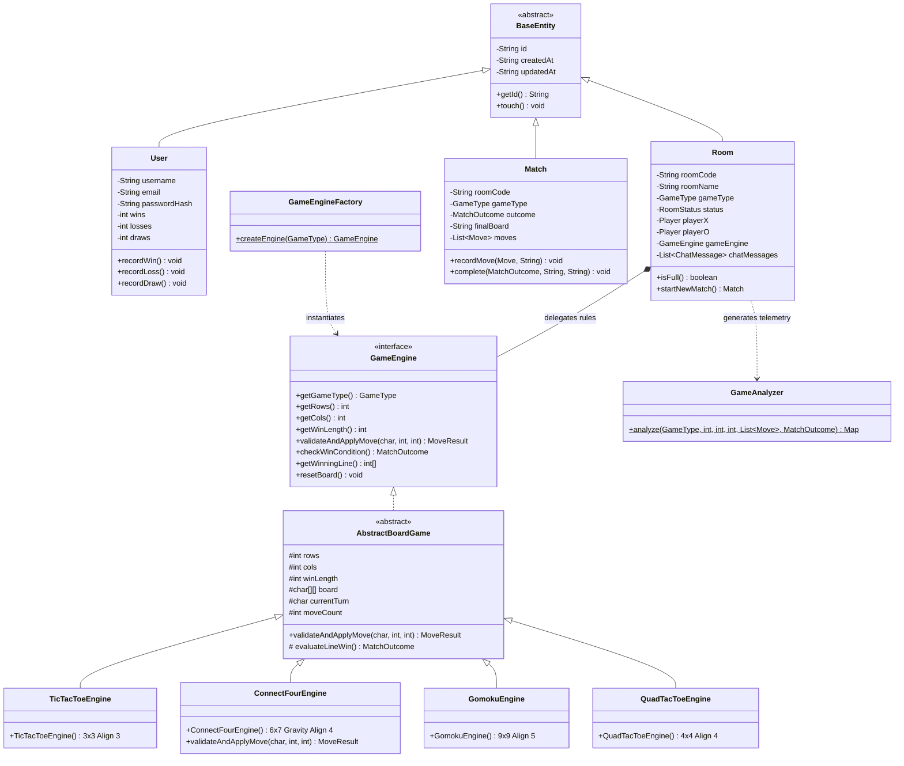
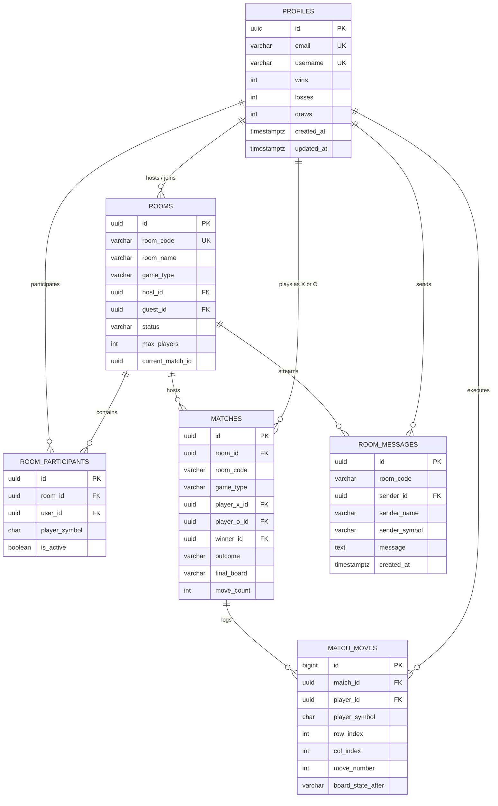

# NEXUS — Real-Time Multiplayer Gaming Hub & Live Tactical Game Analyzer

[](https://nexus-gaminghub-production.up.railway.app)
[](#4-object-oriented-programming-oop-architecture--class-schema)
[](#7-real-time-websocket-protocol)
[](#8-supabase-database-schema--er-diagram)

**NEXUS** is a server-authoritative, real-time multiplayer gaming hub built from the ground up using a **modular Java Object-Oriented Programming (OOP) backend**, a **custom RFC 6455 WebSocket server**, **Supabase Authentication & PostgreSQL persistence**, and an **Architectural Daylight HTML5 / CSS3 / Vanilla ES6+ frontend**.

Players can register or sign in, create or join 6-character room codes, choose from **four competitive 2-player grid games**, chat live inside the room with quick tactical presets, and inspect **live & post-match tactical game analysis** (move accuracy, winning threat detection, defensive saves, board control dominance, and opening classification).

- **Live Production App:** [https://nexus-gaminghub-production.up.railway.app](https://nexus-gaminghub-production.up.railway.app)
- **GitHub Repository:** [https://github.com/Singh08042007/GameNexus.git](https://github.com/Singh08042007/GameNexus.git)
- **Detailed Team Documentation:** [`team details.md`](./team%20details.md) / [`TEAM_DETAILS.md`](./TEAM_DETAILS.md)

---

## 1. Team Details

| # | Teammate Name | Roll No. | Role & Focus Area |
| :-: | :--- | :--- | :--- |
| 1 | **Deepinder Singh** | `247046` | Lead Backend Architect, Supabase Cloud Integration & Railway Docker Deployment |
| 2 | **Gourav Garg** | `2547061` | Multi-Game Engine Developer & Tactical Game Analysis (`GameAnalyzer`) |
| 3 | **Harsh Dhiman** | `2547068` | RFC 6455 WebSocket Server, Matchmaking Rooms & Live Room Chatroom |
| 4 | **Hitika** | `2547077` | Architectural Daylight Frontend UI/UX, Dynamic Board Renderer & Automated Testing |

> See [`team details.md`](./team%20details.md) for a full module-by-module breakdown of each teammate's contributions.

---

## 2. Key Features

### Four Playable Multiplayer Grid Games
Every room lets the host pick one of four server-validated board games powered by polymorphic Java game engines:
1. **Tic-Tac-Toe (`3×3` Classic Grid · Align 3)**: Fast-paced tactical duel with center/corner opening classification and fork detection.
2. **Connect Four (`6×7` Gravity Drop Rack · Align 4)**: Players select any column (`Col 1`–`Col 7`); discs automatically drop to the lowest unoccupied row in that column.
3. **Gomoku (`9×9` Strategy Board · Align 5)**: Deep 81-cell positional strategy where players build intersecting lines to align 5 consecutive stones.
4. **Quad-Tac-Toe (`4×4` Extended Arena · Align 4)**: Expanded 16-cell tactical arena emphasizing central `2×2` core control.

### Real-Time In-Room Chatroom
- **Instant Bidirectional Messaging**: Players in a room can chat before, during, and after matches over WebSockets (`SEND_CHAT` / `CHAT_MESSAGE`) with REST fallback (`POST /api/rooms/chat`).
- **Tactical Quick-Chat Presets**: One-click chips (*"Good luck!"*, *"Nice move!"*, *"Watch that fork!"*, *"Great block!"*, *"Rematch?"*).
- **Automated Arena Director Announcements**: System messages announce room creation, challenger arrival, match victories/draws/forfeits, and rematch resets.

### Live & Post-Match Tactical Game Analysis (`GameAnalyzer`)
After every move—and in the Match History archive—the Java `GameAnalyzer` simulates board lines to compute:
- **Move-by-Move Classification**:
  - `WINNING_STRIKE` (+100 score) — Completes the required N-in-a-row line
  - `DOUBLE_THREAT_FORK` (+95 score) — Creates 2+ simultaneous winning threats
  - `CRITICAL_BLOCK` (+90 score) — Denies an opponent's immediate winning threat
  - `TACTICAL_THREAT` (+82 score) — Sets up a 1-move-away winning line
  - `CENTER_CONTROL` (+78 score) — Claims high-value central board territory
  - `POSITIONAL_PLAY` (+72 score) — Standard developing move
  - `MISSED_DEFENSE` (+35 score) — Fails to block an opponent's immediate threat
- **Player X & Player O Move Accuracy (%)**
- **Board Control Dominance Share (`X Control %` vs `O Control %`)**
- **Opening Classification, Key Turning Point & Executive Summary**

---

## 3. System Workflow & Architecture Flowcharts

### 3.1 High-Level System Architecture & Cloud Ingress Flowchart



---

### 3.2 End-to-End Player & Matchmaking Workflow



---

### 3.3 Real-Time Move Validation, Chat & Analysis Sequence Diagram



---

### 3.4 Room Lifecycle State Machine



---

## 4. Object-Oriented Programming (OOP) Architecture & Class Schema

The backend (`src/main/java/com/nexus/gaming/`) is designed as a clean demonstration of core Java OOP principles:



| OOP Principle | Implementation in NEXUS |
| :--- | :--- |
| **Abstraction** | `GameEngine` interface and `AbstractBoardGame` abstract base class define the contract (`validateAndApplyMove`, `getBoardString`, `getWinningLine`, `checkWinCondition`) while hiding N-in-a-row directional scanning mechanics. |
| **Inheritance** | `TicTacToeEngine`, `ConnectFourEngine`, `GomokuEngine`, and `QuadTacToeEngine` inherit board state management and win detection from `AbstractBoardGame`. Domain models (`User`, `Player`, `Room`, `Match`, `Move`) inherit identity and timestamps from `BaseEntity`. |
| **Polymorphism** | `Room` holds a polymorphic `GameEngine` reference created via `GameEngineFactory.createEngine(GameType)`. `ConnectFourEngine` overrides `validateAndApplyMove()` to implement gravity-based column dropping while sharing directional win detection. |
| **Encapsulation** | All domain models (`Room`, `Match`, `User`, `ChatMessage`, `AppConfig`) keep state fields `private`, expose controlled mutators, and synchronize state transitions. |
| **Factory Pattern** | `GameEngineFactory` instantiates the concrete `GameEngine` implementation corresponding to the room's selected `GameType`. |
| **Custom Exception Hierarchy** | `NexusException` base runtime exception with HTTP status codes, extended by `AuthenticationException` (401), `AuthorizationException` (403), `ResourceNotFoundException` (404), `RoomException` (400/409), and `InvalidMoveException` (422). |
| **Thread Safety & Concurrency** | `ConcurrentHashMap` repositories and room-level `synchronized (room)` locks guarantee that simultaneous moves or join requests never corrupt board state. |

---

## 5. Project Directory Structure

```text
Nexus-GamingHUB/
├── Dockerfile                      # Multi-stage Java 17 + Nginx single-port container build
├── .env.example                    # Template for environment variables
├── README.md                       # Project documentation & workflow schemas
├── TEAM_DETAILS.md                 # Team roster & module ownership
├── team details.md                 # Team roster & module ownership
├── database/
│   └── schema.sql                  # Supabase PostgreSQL tables, constraints, triggers & RLS
├── scripts/
│   ├── run.ps1                     # Compiles and starts the local NEXUS server
│   └── test.ps1                    # Compiles and runs the 29-test verification suite
├── frontend/
│   ├── index.html                  # Single-page app (Landing, Auth, Lobby, Arena, Analysis)
│   ├── css/
│   │   ├── tokens.css              # Warm Alabaster & Crisp Paper daylight design tokens
│   │   ├── base.css                # Reset, typography & accessible browser surfaces
│   │   └── nexus.css               # 3-column Arena, 4 board grids, chatroom & telemetry UI
│   └── js/
│       ├── api.js                  # Fetch REST client with Bearer token session storage
│       ├── ws.js                   # Auto-reconnecting RFC 6455 WebSocket client
│       └── app.js                  # Main UI controller, board renderer & analysis binder
└── src/
    ├── main/java/com/nexus/gaming/
    │   ├── NexusApplication.java   # Server entry point & WebSocket message router
    │   ├── config/                 # EnvLoader & immutable AppConfig
    │   ├── controller/             # ApiController (REST endpoints + static file server)
    │   ├── dto/                    # DtoMapper (JSON payloads + live GameAnalyzer injection)
    │   ├── engine/                 # GameEngine, AbstractBoardGame, 4 engines, Factory, Analyzer
    │   ├── exception/              # Custom HTTP-mapped exception hierarchy
    │   ├── model/                  # BaseEntity, User, Player, Room, Match, Move, ChatMessage
    │   ├── repository/             # Repository<T>, DataRepository, SupabaseClient
    │   ├── service/                # AuthService, RoomService, GameService
    │   ├── util/                   # Zero-dependency JsonUtil parser/serializer & SecurityUtil
    │   └── websocket/              # RFC 6455 WebSocketHub & WebSocketConnection
    └── test/java/com/nexus/gaming/
        └── NexusTestSuite.java     # 29 end-to-end automated unit & concurrency tests
```

---

## 6. REST API Specification

| Method | Endpoint | Auth | Description |
| :--- | :--- | :-: | :--- |
| `GET` | `/api/health` | No | Returns server status, WebSocket port, and Supabase connectivity |
| `GET` | `/api/games` | No | Lists all 4 supported games (`rows`, `cols`, `winLength`, description) |
| `POST` | `/api/auth/register` | No | Registers a new player account (`username`, `email`, `password`) |
| `POST` | `/api/auth/login` | No | Authenticates via email/username + password and issues a session token |
| `POST` | `/api/auth/logout` | Yes | Invalidates the caller's active Bearer token |
| `GET` | `/api/auth/me` | Yes | Returns the authenticated player's profile and career W/L/D stats |
| `GET` | `/api/rooms` | Yes | Lists all open/active multiplayer rooms in the lobby |
| `POST` | `/api/rooms/create` | Yes | Creates a new room with chosen `roomName` and `gameType` |
| `POST` | `/api/rooms/join` | Yes | Joins a room by 6-character `roomCode` (or reconnects existing member) |
| `POST` | `/api/rooms/leave` | Yes | Leaves a room (triggers `FORFEIT` win for remaining player if mid-match) |
| `POST` | `/api/rooms/rematch` | Yes | Resets the board and swaps X/O roles for an immediate rematch |
| `POST` | `/api/rooms/chat` | Yes | Posts a real-time chat message to the room and broadcasts via WebSocket |
| `GET` | `/api/rooms/{CODE}` | Yes | Fetches full room state, board array, chat history, and live analysis |
| `POST` | `/api/game/move` | Yes | Validates and applies a move (`roomCode`, `row`, `col`) |
| `GET` | `/api/matches` | Yes | Returns recent completed matches with full post-game analysis reports |
| `GET` | `/api/matches/analysis/{ID}` | Yes | Returns deep tactical analysis for a specific match ID |
| `GET` | `/api/leaderboard` | Yes | Returns top players ranked by wins and win rate |

---

## 7. Real-Time WebSocket Protocol

- **Endpoint:** `ws://localhost:8081/ws?token=<TOKEN>&roomCode=<CODE>` (or `wss://<domain>/ws` in production)
- **Client → Server Actions:**
  - `{"action": "SUBSCRIBE_ROOM", "roomCode": "NX4820"}`
  - `{"action": "MAKE_MOVE", "roomCode": "NX4820", "row": 1, "col": 1}`
  - `{"action": "SEND_CHAT", "roomCode": "NX4820", "message": "Good luck!"}`
  - `{"action": "PING"}`
- **Server → Client Broadcast Events:**
  - `ROOM_CREATED`, `ROOM_JOINED`, `ROOM_UPDATED`, `ROOM_LEFT`, `REMATCH_STARTED`, `LOBBY_UPDATED`
  - `MOVE_MADE`, `MATCH_ENDED`
  - `CHAT_MESSAGE`
  - `PONG`, `ERROR`

---

## 8. Supabase Database Schema & ER Diagram

### 8.1 Entity-Relationship Schema (`database/schema.sql`)



### 8.2 Provisioning Steps
1. Create a Supabase project and copy `.env.example` to `.env` with your `SUPABASE_URL`, `SUPABASE_ANON_KEY`, and `SUPABASE_SECRET_KEY`.
2. Open **Supabase Dashboard → SQL Editor → New Query**.
3. Paste and run [`database/schema.sql`](./database/schema.sql) to provision all tables, constraints, triggers (`on_auth_user_created`), and Row-Level Security (RLS) policies.

---

## 9. Local Setup, Testing & Deployment

### Prerequisites
- **Java JDK 17+** (compatible with Java 8 through Java 25)
- **PowerShell** (Windows) or POSIX shell

### Run the 29-Test Automated Verification Suite
```powershell
powershell -ExecutionPolicy Bypass -File scripts/test.ps1
```
Verifies all 4 game engines (`TicTacToe`, `ConnectFour`, `Gomoku`, `QuadTacToe`), `GameAnalyzer` accuracy/evaluations, user registration/login, room capacity, live chat authorization, move validation, simultaneous move race conditions, forfeit handling, and persistence.

### Start the Local Server
```powershell
powershell -ExecutionPolicy Bypass -File scripts/run.ps1
```
- **Web App & REST API:** `http://localhost:8080`
- **WebSocket Server:** `ws://localhost:8081/ws`

### Deploy with Docker / Railway
```bash
docker build -t nexus-gaminghub .
docker run -p 8080:8080 --env-file .env nexus-gaminghub
```
Or deploy directly to Railway:
```bash
railway up
```
